

<a href="https://adacoder.com"></a>


 


✍️ Side quest: I write about frontend on <a href="https://blog.openreplay.com/authors/adaeze-ndupu/"><b>OpenReplay</b></a> and <a href="https://hashnode.com/@vermilion"><b>Hashnode</b></a> &nbsp;·&nbsp; 💬 <a href="https://github.com/vermilion4/vermilion4/issues/new"><b>Ask me anything</b></a>, PRs and issues always welcome

  



  

 

  

  

<table>
  <tr>
    <td width="33%" align="center" valign="top">
      <a href="https://appnigma.ai"></a>
       <a href="https://appnigma.ai"><b>▶ Live site</b></a>
    </td>
    <td width="33%" align="center" valign="top">
      <a href="https://handovr-drxq.onrender.com"></a>
       <a href="https://handovr-drxq.onrender.com"><b>▶ Live demo</b></a> · <a href="https://github.com/vermilion4/Handovr-AI"><b>💾 Code</b></a>
    </td>
    <td width="33%" align="center" valign="top">
      <a href="https://inkswap.netlify.app"></a>
       <a href="https://inkswap.netlify.app"><b>▶ Website</b></a> · <a href="https://github.com/vermilion4/ink-swap"><b>💾 Code</b></a>
    </td>
  </tr>
  <tr>
    <td width="33%" align="center" valign="top">
      <a href="https://github.com/vermilion4/couchconsensus"></a>
       <a href="https://github.com/vermilion4/couchconsensus"><b>💾 Code + demo video</b></a>
    </td>
    <td width="33%" align="center" valign="top">
      <a href="https://www.minxxclub.com"></a>
       <a href="https://www.minxxclub.com"><b>▶ Live site</b></a>
    </td>
    <td width="33%" align="center" valign="top">
      <a href="https://www.codefunhouse.com"></a>
       <a href="https://www.codefunhouse.com"><b>▶ Live site</b></a>
    </td>
  </tr>
</table>

Also live: <a href="https://www.educatingafricafund.org"><b>Educating Africa</b></a> (non-profit with Stripe donations) · <a href="https://regret-archive.appwrite.network"><b>Regret Archive</b></a> (anonymous lessons-learned platform) &nbsp;·&nbsp; play them all inside <a href="https://adacoder.com"><b>AdaOS, my portfolio</b></a> &nbsp;·&nbsp; <a href="https://github.com/vermilion4?tab=repositories"><b>140+ more repos →</b></a>

  

<a href="https://devpost.com/software/handovr-ai"></a>
<a href="https://devpost.com/software/couch-concensus"></a>
<a href="https://devpost.com/software/inkswap"></a>
<a href="https://devpost.com/software/dealflow-nhf9qt"></a>
<a href="https://devpost.com/software/shipsafe-3zw94e"></a>

 

  

 

  

  

🐍 <b>BONUS STAGE:</b> watch the snake eat my contributions

<picture>
  <source media="(prefers-color-scheme: dark)" srcset="https://raw.githubusercontent.com/vermilion4/vermilion4/output/github-snake-dark.svg" />
  
</picture>

  

 

  

<a href="https://adacoder.com"></a>

